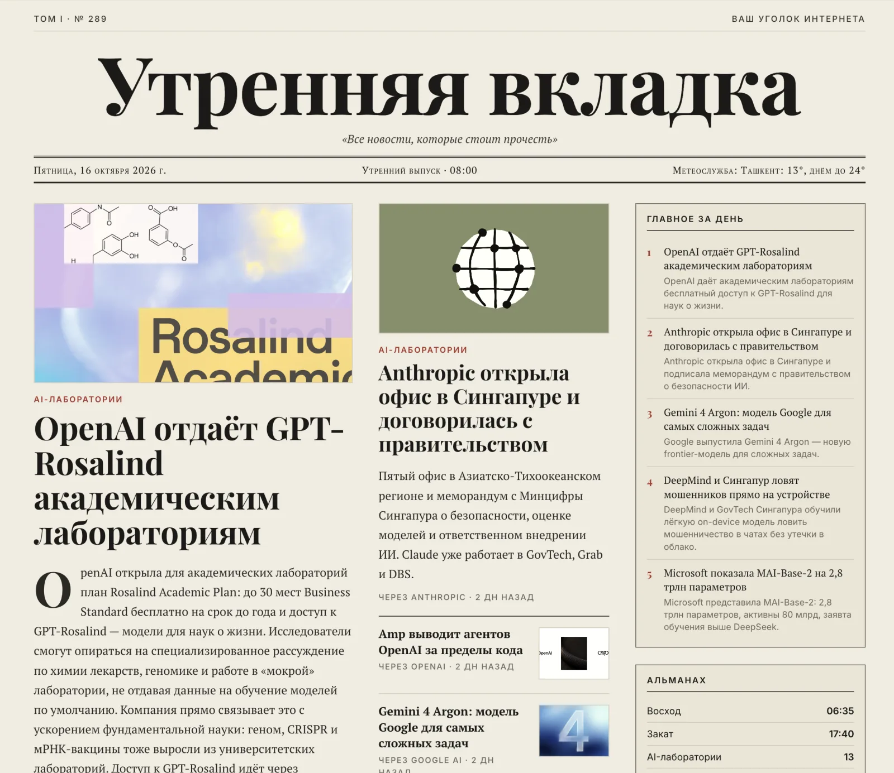

# Утренняя вкладка

Скилл для агентов (Claude Code, Codex и других с shell): каждое утро собирает газетную страницу с главным по вашей теме и публикует её по постоянной ссылке.



- **Любая тема.** При первом запуске агент спрашивает тему и источники или подбирает их сам: Google News, RSS сайтов, Hacker News, arXiv, YouTube, GitHub Trending.
- **Тексты пишет агент** на языке страницы: заголовки, краткие пересказы, «Главное за день». Платных API нет.
- **Проверка окружения перед каждым запуском**: Bun, браузер для скриншота, сеть, вход на хостинг. Если чего-то не хватает, агент говорит, что именно, и просит это настроить.
- **Публикация** на Vercel, Netlify, Cloudflare Pages или GitHub Pages.
- **Ежедневная рутина**: после первого выпуска агент предлагает ставить выпуск на расписание.

## Установка

```
npx skills add smixs/morning-tab
```

Или скопируйте папку `skills/morning-tab` в папку скиллов агента (для Claude Code — `~/.claude/skills/`) и выполните в ней `bun install`.

Дальше скажите агенту: «сделай утреннюю вкладку про <тему>».
